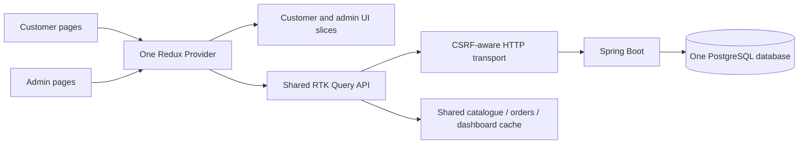

# React architecture

The rizz customer storefront and super admin are two routes in **one React application**, mounted under **one Redux Provider**. They share one API service layer and the same Spring Boot / PostgreSQL backend. There are no separate customer/admin frontend projects or databases.

## Atomic Design

```text
src/
  App.tsx                         Customer/admin route entry; admin is lazy-loaded
  main.tsx                        React root and shared Redux Provider
  components/
    atoms/                        Button, Badge, BrandLogo, ProductImage, ProductArt
    molecules/                    ProductCard, QuantityControl, SearchField, Notice,
                                  CropSelector and ProductGrid
    organisms/
      storefront/                 Header, footer, cart drawer, search and product dialogs
      admin/                      Sidebar, tables and product/category/order editors
      media/                      Crop/resize/upload editor
    templates/                    StorefrontTemplate and AdminTemplate layout slots
  pages/
    StorefrontPage.tsx            Customer flow composition
    AdminPage.tsx                 Admin flow composition
    storefront/                   Home, collection, checkout and success screens
    admin/                        Sign-in, overview, products, categories and orders
  hooks/                          useStorefront and useAdmin feature controllers
  store/                          Redux store, typed hooks, customer/admin slices
  services/                       Shared RTK Query API and CSRF-aware HTTP transport
  types/                          Shared product and admin domain types
  data/                           Preview catalogue and admin form defaults
  utils/                          Currency and date formatting
```

Atoms supply UI primitives. Molecules combine primitives into reusable controls. Organisms compose complete interface sections. Templates define layout slots. Pages connect feature controllers to those compositions. Lower component layers must not import higher layers.

Components receive typed data and callbacks. They do not perform network requests or subscribe to Redux. Feature hooks coordinate behavior; RTK Query coordinates server data. Image crop state stays inside its editor because it belongs to that interaction.

## Shared customer/admin workflow



`src/store/storefrontSlice.ts` holds cart, wishlist, customer navigation, filters, dialog visibility and checkout-step state. Only cart and wishlist are persisted in browser storage; existing storage keys are retained.

`src/store/adminSlice.ts` holds admin navigation, search and pagination. Admin sign-out resets its view and clears cached server data. It does not clear the customer cart or wishlist.

`src/services/storeApi.ts` defines both customer and admin endpoints. Product edits invalidate the shared `Products` tag; category edits invalidate `Categories` and `Products`. Customer checkout and admin fulfillment changes invalidate `Orders`, `Products` and `Dashboard`. Active queries refresh automatically. Separate browser tabs have their own runtime stores and refresh queries when refocused or reconnected.

Delivery/form drafts remain local to their feature controllers. Passwords and image `File`/`FormData` values are not put into Redux actions or cache arguments. Sign-in and image upload use the same CSRF-aware transport directly. RTK Query responses remain serializable. No admin/customer records are persisted in browser storage.

## Development rules

- Build new reusable controls from atoms and molecules before putting compositions in pages.
- Add server endpoints to `storeApi`; give them the appropriate cache tags.
- Keep network calls and Redux subscriptions out of reusable UI components.
- Do not copy API responses into another Redux slice; derive views from RTK Query results.
- Keep form drafts, callbacks, DOM refs and image files out of persisted Redux state.
- Preserve the shared root Provider and the single backend/database arrangement.
- Configure UI branding in `src/brand.defaults.json`, or use `VITE_APP_NAME` when building.

## Verification

```sh
npm test
npm run format:check
npm run build
```

The tests enforce the component dependency direction and keep API calls out of reusable UI. Workflow tests verify customer/admin catalogue invalidation, checkout inventory/order updates, failed-edit behavior, and customer-state preservation across admin navigation.
